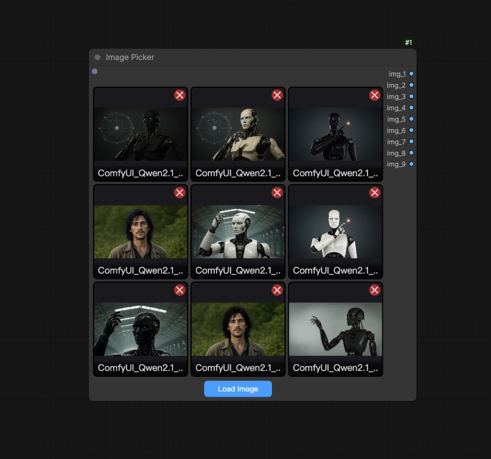
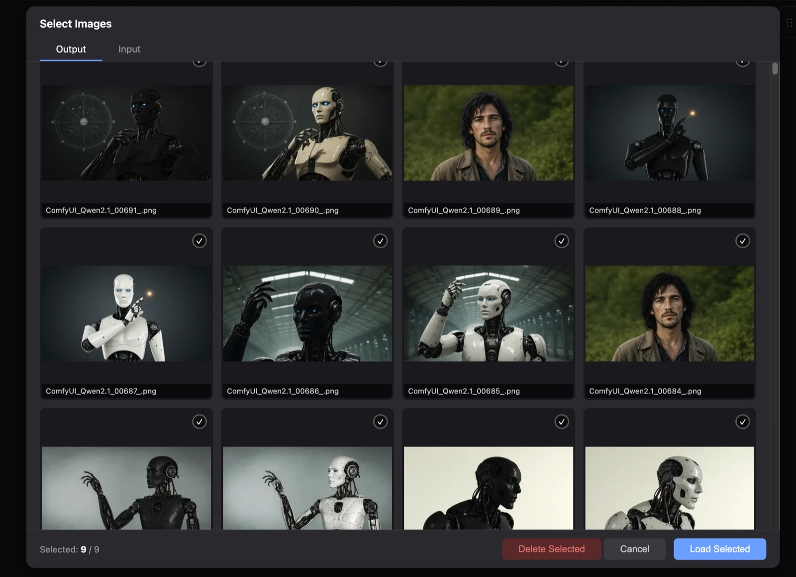

# ComfyUI Image Picker

一个可视化「多图选择」节点：在节点上点 **Load Image** 打开图库弹窗，从 ComfyUI 的 `input` / `output` 目录里挑图（最多 9 张），节点一次性输出 9 个 `IMAGE` 端口。

适合一次性喂多张参考图、做对比图生图、批量换脸等场景，省去反复添加 LoadImage 节点。



## 功能

**图库弹窗**



- `Input` / `Output` 两个 tab，网格预览，最近修改的图排在前面
- 最多选 9 张，选中后有蓝色描边和计数提示
- 支持直接删除：选中后 `Delete Selected` 会**从磁盘删除文件**（带二次确认）
- 缩略图滚动懒加载（`IntersectionObserver`，提前 400px 预取），不会一次拉几百张原图

**服务端缩略图**

- `/image_picker/thumb` 按最长边缩到 512px 并落盘为 WebP（质量 70，约 20KB/张）
- 缓存文件名编码「源路径哈希 + mtime + 尺寸」，源图一改自动换新文件
- 源图删除时同步清掉它的所有缓存版本；超 10000 个文件或 200MB 按最旧清理
- 带 `immutable` 长缓存头，节点画布与弹窗共用同一份浏览器缓存

**节点内交互**

- 节点里直接画出 3 列缩略图网格，带文件名和逐张删除按钮
- 选中的缩略图可以在节点内拖动排序，顺序即输出端口顺序
- 把系统里的图片文件直接拖到节点上，会自动上传到 `input` 并加入节点

## 安装

```bash
cd ComfyUI/custom_nodes
git clone https://github.com/YangShu2103/ComfyUI_image_picker.git ComfyUI_image_picker
```

重启 ComfyUI，节点出现在 `image` 分类下，显示名 **Image Picker**。

依赖都是 ComfyUI 自带的（`torch`、`numpy`、`Pillow`），不需要额外安装。

## 使用

1. 在画布上添加 **Image Picker** 节点。
2. 点节点下方的 **Load Image** 按钮，打开图库弹窗。
3. 切换 `Input` / `Output`，点击图片选中（最多 9 张，再点一次取消）。
4. 点 **Load Selected**，图片回填到节点，按顺序对应后面的输出端口。
5. 需要删图时，选中后点 **Delete Selected**（注意：会直接删除磁盘上的文件）。
6. 也可以把本地图片文件拖到节点上，自动上传进 `input` 目录并加入节点。

## 输出

| 端口 | 类型 | 说明 |
| --- | --- | --- |
| `img_1` … `img_9` | `IMAGE` | 按选择顺序输出；没选中的端口输出 `None` |

节点上的 `image_paths` 输入框已自动隐藏，路径由弹窗与拖拽维护（JSON 数组形式的绝对路径）。

## 缩略图缓存

缓存目录：`<user_directory>/image_picker_thumbs`（`folder_paths.get_user_directory()`，拿不到时退回节点目录）。可以整个删掉，下次访问会自动重建。

- 文件名：`md5(源文件真实路径)[:16]__mtime__尺寸.webp`
- 清理策略：超过 10000 个文件或 200MB 时，按最旧的先删（60 秒节流检查一次）

## 接口

| 方法 | 路径 | 说明 |
| --- | --- | --- |
| GET | `/image_picker/files?type=input\|output` | 列出目录内的图片（含子目录，按 mtime 倒序） |
| GET | `/image_picker/thumb?path=&size=512` | 缩略图（WebP 缓存，仅允许 input/output 内的文件） |
| POST | `/image_picker/update_config` | 同步节点的图片数量与路径到后端 |
| POST | `/image_picker/delete_files` | 删除文件（校验 realpath 必须在 input/output 内） |

## 目录结构

```
ComfyUI_image_picker/
├── __init__.py         # 节点定义、API 路由、缩略图生成与缓存
├── js/image_picker.js  # 节点绘制、图库弹窗、拖拽上传与排序
└── docs/images/        # README 截图
```

## 常见问题

**弹窗里一张图都没有？**
只识别 `.png / .jpg / .jpeg / .webp / .bmp`，确认 `input` 或 `output` 目录里确实有这些文件。

**输出是空的？**
看 ComfyUI 控制台里的 `[ImagePicker] Path not found` 日志，通常是图片路径已失效（文件被移动或删除）。

**删除失败？**
出于安全考虑，只允许删除 `input` / `output` 目录内的文件，其他路径会被拒绝。

**节点缩略图不刷新？**
缩略图 URL 带源文件 `mtime`，正常会自动更新；必要时删掉 `image_picker_thumbs` 目录。

## 许可证

[MIT](LICENSE) © 2026 YangShu2103
